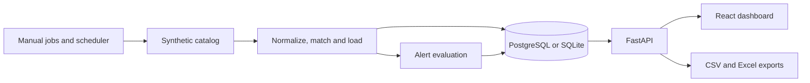

# E-commerce Competitor Price Intelligence System

A full-stack demo by Faizan Akhtar for comparing competitor prices, tracking inventory and price history, and reviewing collection jobs and alerts.

## What it does

- **Dashboard and catalog.** View pricing and inventory KPIs, daily price statistics for the preceding 30 days, category and retailer breakdowns, searchable products, matched offers and per-retailer price history.
- **Competitor comparison.** Choose a reference retailer to see absolute and percentage price differences and identify undercutting.
- **Alerts and collection jobs.** Review price changes, stock transitions and undercutting, acknowledge or resolve alerts, and trigger and inspect demo collection runs. A separate APScheduler worker runs the synthetic connector at startup and at configurable intervals. The recurring job allows one instance per worker.
- **Settings and exports.** Export current offers as CSV or a single-sheet Excel workbook, with an optional category filter. The settings screen stores edits in the running API process. Configure the scheduler through environment variables.
- **Data pipeline.** Normalizes and deduplicates incoming offers, matches products by GTIN, brand and model, then canonical name, and upserts offers and price observations. Default collection uses synthetic data. The repository also includes an HTTP JSON connector and a Playwright connector for a sample storefront with the expected selectors. These require a compatible source and separate wiring into the collection jobs.

The default seed creates 500 products, 3 fictional retailers, 1,500 offers and 135,000 price observations spanning 90 days. Demo prices and seller links are synthetic. The React dashboard has seven views, including the product detail and settings pages. The FastAPI root serves a separate lightweight preview that loads assets from public CDNs.

## Architecture



The backend uses Python 3.13, FastAPI, SQLAlchemy, Alembic, APScheduler, pandas and OpenPyXL. The frontend uses React 18, TypeScript, Vite, Tailwind CSS, Recharts and TanStack Query.

## Run with Docker Compose

Run this command from the project root.

```bash
docker compose up --build -d
```

Open the dashboard at [http://localhost:5173](http://localhost:5173) or [http://localhost](http://localhost). The API docs are at [http://localhost:8000/docs](http://localhost:8000/docs). PostgreSQL is on localhost port 5432. The backend seeds an empty catalog on startup. Compose publishes ports on loopback and uses demo credentials and settings.

## Run locally

Install Python 3.13 and Node.js 20. Run these commands from the project root in an activated Python environment.

```bash
python -m pip install -r backend/requirements.txt
python scripts/seed_demo.py
cd backend
python -m uvicorn app.main:app --host 127.0.0.1 --port 8000
```

The seed script creates the schema and replaces existing records in its configured database. Use it with a disposable demo database. With default settings, it writes to `backend/app.db`. Copy `.env.example` to `backend/.env` only if you want overrides.

Run the frontend commands from the project root in a second terminal.

```bash
cd frontend
npm ci
npm run dev
```

Open [http://localhost:5173](http://localhost:5173). Vite proxies API calls to port 8000. To run scheduled collection locally, start `python -m app.scheduler.worker` from `backend` in a separate terminal after seeding. The optional sample storefront connector requires `python -m playwright install chromium` and a compatible storefront.

## Checks

Run the backend checks from `backend`.

```bash
python -m ruff check .
python -m pytest tests/ -v
```

From `frontend` after installing dependencies, run `npm run build` to type-check and create the Vite build. GitHub Actions runs both sets of checks.

## Documentation

- [Architecture](docs/architecture.md)
- [Data pipeline](docs/data-pipeline.md)
- [Database schema](docs/database-schema.md)
- [API guide](docs/api-guide.md)
- [Deployment and operations](docs/deployment.md)
- [Portfolio case study](case-study.md)

