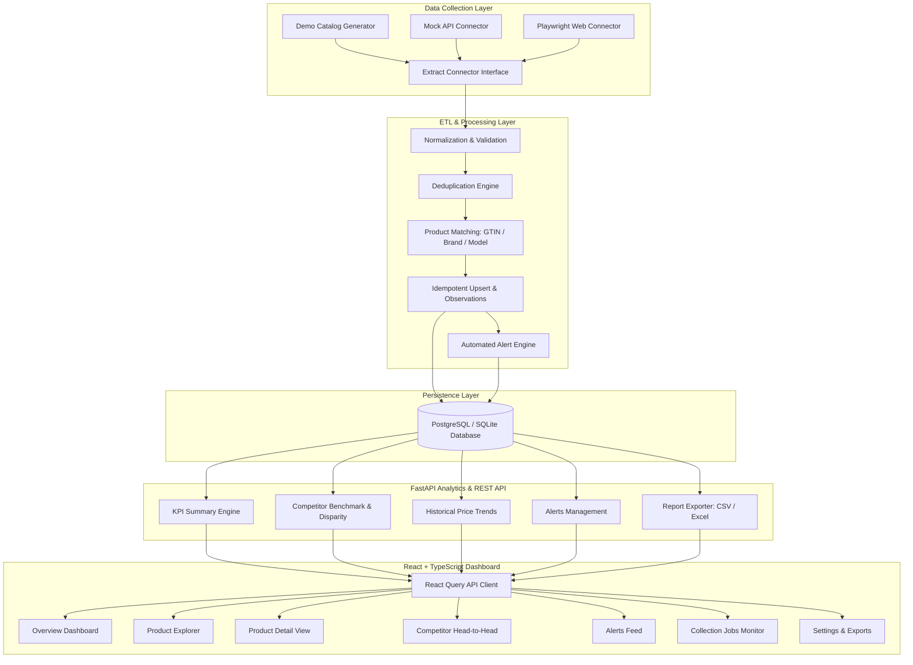

# System Architecture: E-commerce Competitor Price Intelligence

## 1. High-Level System Overview

The **E-commerce Competitor Price Intelligence System** is an enterprise-grade platform designed to collect, clean, standardize, analyze, and visualize competitor pricing, product availability, and promotional trends across multiple e-commerce retailers.

---

## 2. Component Design

### 2.1 Connector Interface & Acquisition
Data extraction is decoupled via `BaseConnector`:
- **DemoCatalogConnector**: Deterministic synthetic generation supporting reproducible demo sets (500 products, 3 retailers, 90 historical days).
- **MockAPIConnector**: HTTPX-based API connector with error handling and request timeouts.
- **PlaywrightStorefrontConnector**: Headless browser automation targeting permitted sample storefronts.

### 2.2 ETL & Matching Engine
- **Normalization**: Standardizes prices to `Decimal(0.01)`, currency codes (ISO 4217), and availability statuses (`in_stock`, `limited`, `out_of_stock`).
- **Product Matching**: Priority-based deterministic resolution:
  1. Exact Global Trade Item Number (GTIN / EAN) match.
  2. Brand + Model number match.
  3. Canonical product title match.
- **Idempotent Loading**: Guarantees that repeating an extraction run does not insert duplicate observations.

### 2.3 Automated Alert Engine
Evaluates market changes upon each pipeline run:
- **Price Drops / Increases**: Percent deviation against previous observation.
- **Competitor Undercutting**: Flags any competitor offering a lower price than the designated reference retailer.
- **Inventory Transitions**: Detects out-of-stock and back-in-stock events.
- **Deduplication**: Suppresses redundant alert triggers when the condition is already active.

### 2.4 Scheduler & Worker Service
- Built on APScheduler with background thread execution.
- Guarantees strict non-overlapping runs via `max_instances=1` and `coalesce=True`.
- Retains full job logs and run history in the database.
