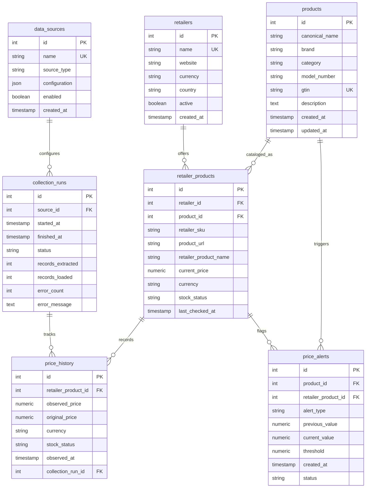

# Database Schema: E-commerce Competitor Price Intelligence

## 1. Entity-Relationship Diagram

## 2. Table Definitions

### `retailers`
Stores profiles of monitored e-commerce competitors and reference stores.
- **Constraints**: `UNIQUE(name)`

### `products`
The master canonical product catalog.
- **Constraints**: `UNIQUE(gtin)`
- **Indexes**: `ix_products_canonical_name`, `ix_products_category`

### `retailer_products`
The cross-reference offer entity linking a specific retailer's listing to a canonical product.
- **Constraints**: `UNIQUE(retailer_id, product_id)`

### `price_history`
Granular time-series price snapshots over time.
- **Constraints**: `UNIQUE(retailer_product_id, observed_at, observed_price)` for duplicate protection.
- **Indexes**: `ix_price_history_observed_at`

### `price_alerts`
Active and acknowledged notifications generated by price movements or stock transitions.
- **Indexes**: `ix_price_alerts_status`

### `collection_runs`
Audit and observability ledger tracking pipeline execution status, counts, and error messages.
